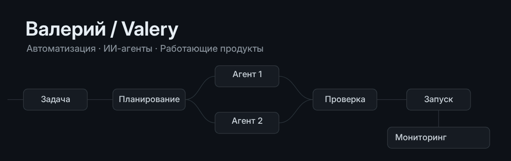
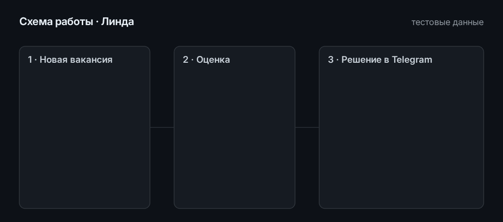
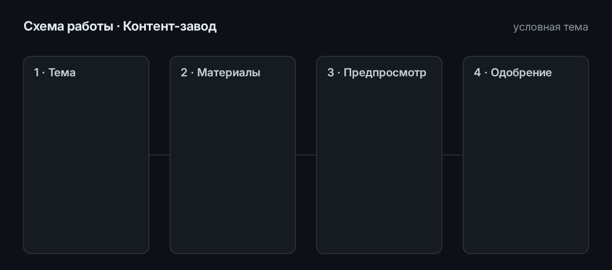

<a href="README.en.md">English</a>

Создаю и сопровождаю автоматизацию на ИИ-агентах: от отбора вакансий до производства видео. Веду полный цикл — постановка задачи, разработка с агентами, проверка, запуск и эксплуатация.

**[Портфолио](https://vanatat.ru/) · [Telegram @fanatat](https://t.me/fanatat)**

Открыт к удалённой работе, проектам и частичной занятости.

## Проекты

### Линда — отбор вакансий

Человек тратит время только на вакансии, которые ему подходят. Каждые 15 минут Линда собирает новые вакансии с hh.ru и Хабр Карьеры, правила профиля и две модели отсеивают и оценивают их от 0 до 100, а отклик уходит только после подтверждения человека.

Работает с сентября 2026. К 18 октября собрано около 12 тысяч вакансий, человеку показано меньше 3 % из них, 77 откликов отправлено после подтверждения. Если площадка меняет вёрстку, ИИ чинит парсер в песочнице — правка принимается только при зелёных тестах.

Схема работы на тестовой вакансии; формат карточки — как в боте.

Python · SQLite · Telegram Bot API · Claude и Gemini · Playwright

### Контент-завод — короткие видео

Из темы получается готовый вертикальный ролик: сценарий, проверка фактов, кадры, синтез голоса или запись диктора, субтитры и монтаж. Каждый ролик идёт дальше только после одобрения в Telegram.

Работает с 24 сентября 2026. На 16 октября одобрено 27 роликов по игровому лору и 28 футбольных. Публикация пока выполняется вручную или кнопкой с подтверждением. [Описание на сайте](https://vanatat.ru/projects/content-factory/).

Схема работы; тема условная, кадры ролика не показаны.

Python · ffmpeg · Whisper · синтез речи на GPU · Telegram Bot API

### Автоматизация и база знаний — n8n, RAG, интеграции

Рутинные отчёты и проверки выполняются по расписанию и приходят в Telegram. На своём сервере с октября 2026 работают 10 сценариев n8n: недельный отчёт по играм ВК, утренняя сводка о состоянии сервера, сторож ошибок, приём выгрузок статистики, заявки с сайта.

В отчётах числа считает код, а модель пишет вывод и сверяется с посчитанным. База знаний на Qdrant отвечает по собственным документам в чате n8n и в Telegram-боте; запущена в октябре 2026, качество ответов проверяется сценарием на контрольных вопросах.

n8n · Docker · Qdrant · LLM API · Telegram

## Браузерные игры

Занимался геймдевом: девять игр за три месяца на разных движках. Четыре браузерные игры опубликованы в каталоге ВК — с рекламой, покупками, облачными сохранениями и лидербордами.

- **Словоход** (филворд) — [играть](https://play.vanatat.ru/slovokhod/) · [ВК](https://vk.com/app54674073)
- **Кот и японские кроссворды** — [играть](https://play.vanatat.ru/catnonogram/) · [ВК](https://vk.com/app54676906)
- **Сортировка: Цвет и Форма** — [играть](https://play.vanatat.ru/color-sort/) · [ВК](https://vk.com/app54683949)
- **Две крепости** — [играть](https://play.vanatat.ru/lane-battle/) · [ВК](https://vk.com/app54759696)

## Стек

- **Агенты и модели:** Claude Code, Claude, Gemini, RAG на Qdrant
- **Автоматизация:** Python, n8n, Telegram Bot API, Playwright
- **Эксплуатация:** Linux, systemd, cron, Docker, PostgreSQL, SQLite, резервные копии
- **Продукты:** TypeScript / Next.js, JavaScript / Three.js, ffmpeg

## Как я работаю

Разрабатываю с помощью ИИ-агентов. Формулирую задачи и критерии готовности, проверяю результат тестами и живым запуском, отвечаю за выпуск и сопровождение: расписания, резервные копии, мониторинг. Важные действия в моих системах подтверждает человек.

Большинство систем работает с личными данными и ключами, поэтому код закрыт; архитектуру покажу на созвоне.

## Контакт

Telegram [@fanatat](https://t.me/fanatat) · портфолио [vanatat.ru](https://vanatat.ru/)
